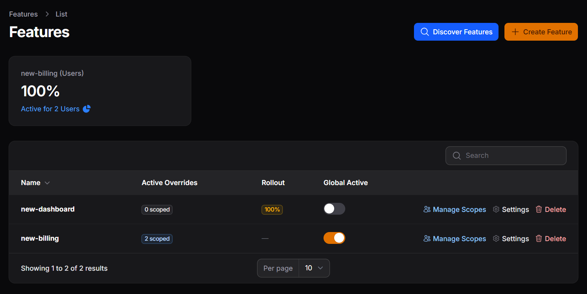
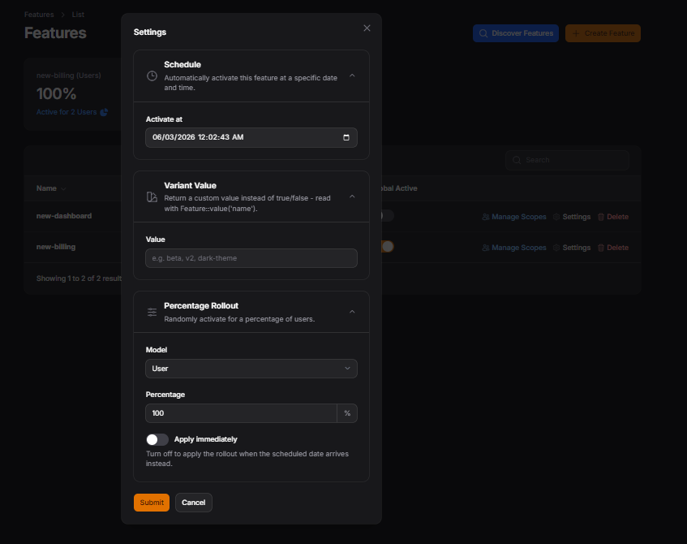
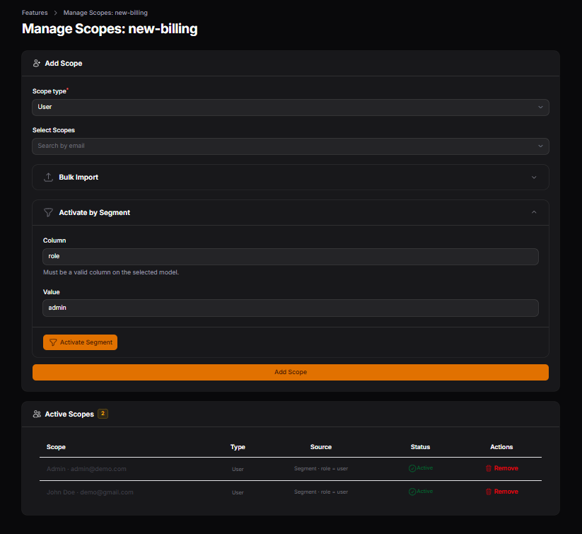

# pennant-manager

[](https://packagist.org/packages/daacreators/pennant-manager)
[](https://packagist.org/packages/daacreators/pennant-manager)

A Filament panel plugin for managing [Laravel Pennant](https://laravel.com/docs/pennant) feature flags - toggle globally, per user or team, bulk import scopes, discover defined features, and track adoption - all without leaving your admin panel.

---

## Screenshots





---

## Requirements

- PHP 8.2+
- Laravel 11.x or 12.x
- Filament 4.x or 5.x
- Laravel Pennant (`laravel/pennant`)

---

## Installation

Install via Composer:

```bash
composer require daacreators/pennant-manager
```

If you haven't already, install Pennant and run its migration:

```bash
composer require laravel/pennant
php artisan migrate
```

Publish the plugin config:

```bash
php artisan vendor:publish --tag="pennant-manager-config"
```

Optionally publish the views to customise them:

```bash
php artisan vendor:publish --tag="pennant-manager-views"
```

---

## Setup

Register the plugin in your Filament panel provider:

```php
use daacreators\PennantManager\PennantManagerPlugin;

public function panel(Panel $panel): Panel
{
    return $panel
        ->plugins([
            PennantManagerPlugin::make(),
        ]);
}
```

---

## Configuration

The existing default store and value-resolution behavior remain unchanged. Optional settings in `config/pennant-manager.php`:

```php
'store' => 'database',       // named Pennant database store; honors its table and connection
'inherit_global' => false,  // opt in to global fallback in FeatureValue::resolveValue()
```

Only database-backed stores are managed by this package. Use the same configured store when reading values through Pennant. The helper defaults to `database` even when the host's default Pennant store is different.

### Upgrading to 1.1.0

No migrations or stored-value rewrites are required. Existing plugin registration, the default `features` table, class-string scope configuration, and JSON envelopes remain supported. Existing published configuration does not need to be overwritten; package defaults supply the new settings. Clear cached configuration after changing settings.

The following corrections can affect custom integrations:

- Registered feature policies now govern navigation and mutations. Scope management requires `viewAny` and `update`; creation/import uses `create`, and deletion uses `delete`. Without a policy, existing Filament panel-user defaults are retained. Restrict your host panel to trusted administrators.
- Scope deletion is confined to the selected feature's non-global rows. Only configured scope models are loaded for display, and configured segment column restrictions are enforced server-side.
- Reapplying a rollout tops up to its target percentage instead of adding the same percentage again. Existing active and inactive overrides are preserved; other models' IDs no longer exclude candidates.
- Malformed schedules are skipped with a warning so other scheduled work can continue. Review command output/logs for skipped entries.
- Missing scoped values still resolve to `false` by default. Enable `inherit_global` explicitly for global fallback. Native JSON scalar variants now resolve consistently; booleans and the existing envelope retain their format.
- New scopes use Pennant's serializer and model primary key. Keep your existing morph-map setting; changing it requires migrating existing scope keys in the host application.
- The scope page accepts a model or record ID during Livewire mounting. Custom subclasses that redeclare its public `record` property must use the compatible `Feature|int|string` union; subclasses that inherit the property need no change.

The new `store` option selects a configured Pennant database store and its connection/table. The package does not migrate tables or move existing records when that option changes.

Laravel 11 remains a compatibility target, but its current resolved framework branch reports dependency advisories. CI reports those separately from compatibility tests. Use a patched dependency graph in production and audit the host application; passing package tests does not establish dependency security. Laravel 12 dependency audits remain blocking in CI.

```php
// config/pennant-manager.php

return [
    'navigation_group' => 'Settings',

    /*
    |--------------------------------------------------------------------------
    | Scope Models
    |--------------------------------------------------------------------------
    | Models that can be used as feature flag scopes.
    | Extended format lets you configure per-model search and display columns.
    */
    'scope_models' => [
        'User' => [
            'model'           => \App\Models\User::class,
            'search_column'   => 'email',   // column used when searching for a scope
            'label_column'    => 'name',    // column shown in the scopes table
            'segment_columns' => ['plan', 'role', 'country'], // optional - restricts Activate by Segment to these columns
        ],
        // 'Team' => [
        //     'model'         => \App\Models\Team::class,
        //     'search_column' => 'name',
        // ],
    ],

    // Global fallback search column - used when a scope_models entry is a plain class string
    'scope_search_column' => 'email',

    /*
    |--------------------------------------------------------------------------
    | Feature Discovery
    |--------------------------------------------------------------------------
    | Paths scanned for Feature::define() calls (files or directories).
    | Scanned features are merged with the manual list in discovered_features.
    */
    'discovery_paths' => [
        app_path('Providers/AppServiceProvider.php'),
        // app_path('Features'),
    ],

    // Manually list features here - useful for features defined dynamically
    // or inside packages that cannot be reliably scanned.
    'discovered_features' => [
        // 'some-dynamic-feature',
    ],
];
```

---

## Features

### Feature List

The main table shows all globally-scoped features. For each feature you can:

- Toggle it **globally on or off** - affects everyone who does not have an explicit scope row
- See how many **per-scope overrides** exist (individual users or teams)
- Open **Settings** for advanced configuration
- Navigate to **Manage Scopes** for per-user or per-team control
- Delete the feature entirely

### Global Toggle vs Scopes

With `pennant-manager.inherit_global` enabled, the plugin's `FeatureValue::resolveValue()` helper uses the global value for a scope without an explicit row:

```
User checks feature
 ├── Has a scope row? → use that value (global is ignored)
 └── No scope row?   → fall back to the global toggle
```

An explicit scope row always wins, including `false`. Global inheritance is disabled by default to preserve earlier versions' behavior. You can keep the global toggle off while enabling selected scopes in either mode.

The package retains its existing JSON envelope (`enabled`, `rich_value`, schedule, and metadata). Read managed flags using `FeatureValue::resolveValue()` so those fields are interpreted correctly; native Pennant checks do not interpret this envelope or implement the helper's optional global fallback. For a model scope, pass `\Laravel\Pennant\Feature::serializeScope($user)` to the helper so custom keys and morph maps match.

---

### Settings

Each feature has a Settings modal with three sections. All three can be configured together in a single save.

#### Schedule

Set a future date and time. The feature stays off until that moment. When the scheduled time arrives, the `pennant:activate-scheduled` command flips it on automatically.

```
Feature is OFF → schedule set for Jun 15 00:00 → command runs → feature turns ON
```

#### Variant Value

Instead of returning `true` or `false`, the feature returns a custom string.
Useful for A/B testing, UI themes, or API versioning.

Set the variant in Settings and read it in your code using the plugin helper:

```php
use daacreators\PennantManager\Support\FeatureValue;

$value = FeatureValue::resolveValue('theme');
// Returns the variant string if active  → 'dark', 'v2', 'beta'
// Returns true if active with no variant set
// Returns false if the feature is inactive
```

You can also check a specific scope (e.g. a user):

```php
$value = FeatureValue::resolveValue('theme', 'App\Models\User|42');
```

#### Percentage Rollout

Randomly activates the feature for a percentage of your users by creating individual scope rows for them. Only users who do not already have a scope row are eligible.

**Apply immediately ON** - scope rows are created the moment you save Settings.

**Apply immediately OFF** - the percentage and model are stored, and the rollout is applied by the scheduled command when the activation date arrives. Use this to combine a rollout with a launch date.

A typical launch flow:

```
Set 30% rollout + Jun 15 activation date + Apply immediately OFF
→ On Jun 15, the command picks 30% of users and activates for them automatically
```

---

### Manage Scopes

Per-feature page for activating or removing the feature for individual users or teams.

**Manual search** - search by the configured column (e.g. email), select one or more records, and activate.

**Bulk import** - paste a list of values (one per line, matching the search column) to activate for many users at once without uploading a file.

**Activate by Segment** - activate for all records matching a column condition, e.g. all users where `plan = pro` or `country = US`. If `segment_columns` is configured for the model, a dropdown restricts which columns can be filtered on. Otherwise any column name can be entered freely.

The scopes table shows each activated record, their model type, and whether their scope is currently active or inactive.

---

### Feature Discovery

Scans your configured `discovery_paths` for `Feature::define()` calls - both string-keyed and class-based - and merges results with any features listed manually in `discovered_features`. Opens a modal showing features found in code but not yet in the database, all pre-selected for one-click import.

```php
// Both of these are detected automatically
Feature::define('new-dashboard', fn (User $user) => false);
Feature::define(BetaFeature::class, fn (User $user) => false);
```

---

### Adoption Stats

A stats widget at the top of the feature list showing per-feature adoption - what percentage of each model type has that feature currently active.

---

## Defining Features

Define features the standard Pennant way in your `AppServiceProvider`:

```php
use Laravel\Pennant\Feature;

public function boot(): void
{
    Feature::define('new-dashboard', fn (User $user) => $user->isOnProPlan());

    Feature::define(BetaFeature::class, fn (User $user) => false);
}
```

After defining features, open the **Discover Features** action in the panel to import them into the database.

---

## Scheduling

To activate scheduled features and apply deferred rollouts automatically, add the command to your scheduler:

```php
// routes/console.php
use Illuminate\Support\Facades\Schedule;

Schedule::command('pennant:activate-scheduled')->everyMinute();
```

You can also run it manually at any time:

```bash
php artisan pennant:activate-scheduled
```

---

## Support the Project

If this package saves you time or helps your business, consider supporting its development.

[Support the Project](https://jabirmayar.gumroad.com/coffee)

## Contributing

Please see [CONTRIBUTING](.github/CONTRIBUTING.md) for details.

## Security Vulnerabilities

Please review [our security policy](SECURITY.md) on how to report security vulnerabilities.

## Credits

- [Jabir Khan](https://github.com/jabirmayar)
- [All Contributors](../../contributors)

## License

The MIT License (MIT). Please see [License File](LICENSE.md) for more information.
